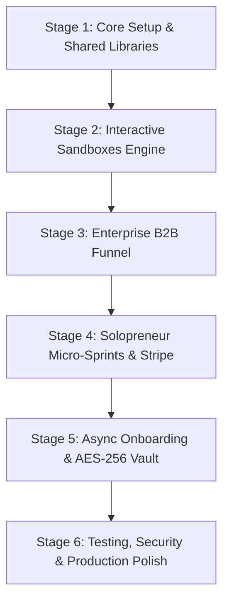

# IxMaOperations — Dual-Funnel AI Engineering & Micro-SaaS Platform

> **Developer & Architecture Blueprint**  
> *Target Branch:* `dev` | *Primary Tech Stack:* Next.js 15 (React 19) / TypeScript / Tailwind CSS / Radix UI / Zustand / Supabase / Stripe

---

## 1. Project Mission & Executive Goal

**IxMaOperations** is a dual-funnel productized AI engineering platform designed to solve a fundamental agency scaling dilemma:
How to capture **High-Ticket Enterprise B2B Contracts** ($5,000 – $25,000+ custom deployments) while simultaneously generating zero-touch, recurring revenue from **Solopreneurs & Creators** ($499 – $1,499 48-hour micro-sprints), without diluting brand authority or cannibalizing high-ticket value propositions.

### The Dual-Funnel Strategy:
```
                                 [ IxMaOperations Platform ]
                                              │
                      ┌───────────────────────┴───────────────────────┐
                      ▼                                               ▼
          [ Enterprise B2B Track ]                        [ Solopreneur Track ]
             Route: / & /enterprise                         Route: /tools
   ─────────────────────────────────────────       ─────────────────────────────────────────
   • Target: CTOs, VPs of Eng, Plant Mgrs          • Target: Solopreneurs, Creators, Agencies
   • Value: TensorRT, PLC, LayoutLM, RAG           • Value: 48h turn-around, Zero-touch speed
   • Deal Size: $5,000 – $25,000+                  • Deal Size: $499 – $1,499 (Fixed Scope)
   • Primary CTA: Book Technical Feasibility       • Primary CTA: Launch 48h Micro-Sprint
   • Conversion: Diagnostic audit / Consultation   • Conversion: Instant Stripe self-serve checkout
   • Delivery: 2-4 week sprints, custom SLA        • Delivery: Async Loom + AES-256 Vault + Bot
```

---

## 2. Technical Stack & Architecture

| Layer | Technologies | Purpose |
|---|---|---|
| **Framework** | Next.js 15 / React 19 (App Router) | Hybrid SSR/SSG, Server Actions, Route Handlers |
| **Language** | TypeScript v5+ (Strict Mode) | Full-stack end-to-end type safety |
| **Styling & Theme** | Tailwind CSS + CSS Variables | Dual-theme isolation (High-Tech Industrial Dark vs. Clean Precision Dark) |
| **UI Primitives** | Radix UI / Shadcn UI patterns | Accessible, headless primitives (Dialog, Tabs, Accordion, Slider) |
| **State Management** | Zustand & TanStack Query v5 | Client sandbox state & server polling/caching |
| **Interactive Canvas** | HTML5 Canvas / React Konva | Bounding box overlays, defect heatmaps, OCR highlights |
| **Terminal / Stream** | Server-Sent Events (SSE) + Custom ANSI / Xterm | Live headless scraper execution logs |
| **Form Handling & Validation** | React Hook Form + Zod v3 | Strict runtime validation for API keys, URLs, files |
| **Security & Cryptography** | AES-256-GCM (`crypto.ts`) | Client-side & server-side zero-trust credential encryption |
| **Payments** | Stripe SDK (`@stripe/stripe-js`) | One-time micro-sprints and recurring retainer checkouts |
| **Database & Vector** | Supabase (PostgreSQL + `pgvector`) | Workspace state, project metadata, vector embeddings |

---

## 3. Directory & File Blueprint

```
IxMaOperations/
├── app/
│   ├── (enterprise)/                      # Route Group: Enterprise B2B Track
│   │   ├── layout.tsx                     # Industrial Dark Layout + Header Switcher
│   │   ├── page.tsx                       # High-ticket Positioning & Architecture Hero
│   │   ├── audit/page.tsx                 # 2-Week Discovery Audit Pitch Page
│   │   ├── case-studies/page.tsx          # Industrial CV & Multi-Agent RAG Case Studies
│   │   └── sandbox/page.tsx               # Dedicated Interactive Demos Laboratory
│   ├── (solopreneur)/                     # Route Group: Solopreneur Micro-SaaS Track
│   │   ├── layout.tsx                     # Clean Precision Dark Layout
│   │   ├── tools/page.tsx                 # Catalog of 48-Hour Micro-Sprints ($499 - $1,499)
│   │   ├── tools/[slug]/page.tsx          # Micro-Sprint Landing Page + Direct Stripe Checkout
│   │   ├── onboarding/[orderId]/page.tsx  # Self-Serve Async Intake Form & API Vault
│   │   └── portal/page.tsx                # Client Delivery & Ticket Dashboard
│   ├── api/                               # Backend API Handlers & Simulation Endpoints
│   │   ├── sandbox/alpr/route.ts          # ALPR & Logistics OCR inference proxy
│   │   ├── sandbox/qc/route.ts            # Industrial Defect QA / PatchCore inference proxy
│   │   ├── sandbox/invoice/route.ts       # Multi-Modal Document Vision inference proxy
│   │   ├── sandbox/scrape/route.ts        # SSE Live Playwright Scraping stream
│   │   ├── vault/route.ts                 # Ingestion for AES-256 encrypted credentials
│   │   └── webhooks/stripe/route.ts       # Stripe Webhook fulfillment handler
│   ├── layout.tsx                         # Root layout
│   └── globals.css                        # CSS tokens, theme variables, and keyframe animations
├── components/
│   ├── enterprise/                        # Enterprise-specific components
│   │   ├── HeroSection.tsx                # High-ticket hero with interactive terminal
│   │   ├── ROIStatsGrid.tsx               # Sourced operational benchmark metrics
│   │   ├── ArchitectureDiagram.tsx        # System pipeline & edge/cloud architecture
│   │   └── FeasibilityModal.tsx           # Technical discovery booking modal
│   ├── solopreneur/                       # Solopreneur-specific components
│   │   ├── MicroSprintCard.tsx            # Pricing & deliverables card
│   │   ├── AsyncIntakeForm.tsx            # Loom URL + Requirement intake
│   │   ├── ApiKeyVault.tsx                # AES-256 Client-side Encrypted Vault Form
│   │   └── MicroCheckoutButton.tsx        # Direct Stripe checkout dispatcher
│   ├── sandboxes/                         # Interactive Portfolio Visualizers
│   │   ├── AlprOcrSandbox.tsx             # Demo 1: ALPR & Container OCR
│   │   ├── DefectQcSandbox.tsx            # Demo 2: Manufacturing Defect Heatmap QA
│   │   ├── InvoiceParserSandbox.tsx       # Demo 3: Split-pane Document & Math Validator
│   │   └── ScraperTerminalSandbox.tsx     # Demo 4: Live Headless Scraper SSE Terminal
│   └── ui/                                # Reusable UI Primitives
│       ├── Button.tsx, Card.tsx, Dialog.tsx, Input.tsx, Tabs.tsx, Badge.tsx, etc.
├── lib/
│   ├── crypto.ts                          # AES-256 Encryption & Decryption helpers
│   ├── store.ts                           # Zustand global store for sandboxes & intake
│   ├── stripe.ts                          # Stripe server client & session creator
│   ├── mock-data.ts                       # Realistic industrial samples & benchmark datasets
│   └── utils.ts                           # Tailwind class merging & string formatters
```

---

## 4. Development Stages & Milestones

To ensure high engineering velocity and maintain flawless code quality, work is broken into **6 structured stages**:



### 📍 Stage 1: Core Foundation & Shared Libraries
- [x] **Goal:** Establish strict TypeScript definitions, CSS design system, cryptographic helpers, and global state.
- **Specific Tasks:**
  1. Initialize `package.json` with all verified dependencies.
  2. Implement `app/globals.css` design tokens (Industrial Slate `#0b0f17`, Emerald `#10b981`, Cyan `#06b6d4`, Amber `#f59e0b`).
  3. Build `lib/crypto.ts` with AES-256-GCM encryption/decryption routines using Web Crypto API.
  4. Create `lib/store.ts` Zustand store for sandbox parameter controls and async order progress.
  5. Build reusable UI primitives in `components/ui/` (`Button`, `Input`, `Dialog`, `Tabs`, `Badge`, `Card`, `Progress`).
- **Success Criteria:** `npm run build` compiles with 0 errors; UI tokens render consistently.

---

### 📍 Stage 2: Interactive Portfolio Sandboxes Engine
- [x] **Goal:** Deliver 4 client-facing interactive sandboxes capable of both realistic simulation and live backend proxy inference.
- **Specific Tasks:**
  1. **ALPR Visualizer (`AlprOcrSandbox.tsx` & `/api/sandbox/alpr`):**
     - Image dropzone, canvas bounding box overlay, license plate & container code recognition, latency metric badges (<250ms).
  2. **Defect QA Inspector (`DefectQcSandbox.tsx` & `/api/sandbox/qc`):**
     - Side-by-side view (Original vs. Anomaly Heatmap), confidence score slider, pass/fail status tag, TensorRT latency counter (12ms).
  3. **Multi-Modal Document Parser (`InvoiceParserSandbox.tsx` & `/api/sandbox/invoice`):**
     - Split-pane layout, interactive bounding boxes over invoices, line-item reconciliation table, math verification checker.
  4. **Headless Scraper Terminal (`ScraperTerminalSandbox.tsx` & `/api/sandbox/scrape`):**
     - Live Server-Sent Events (SSE) streaming terminal, real-time Playwright log emulator, downloadable CSV output.
- **Success Criteria:** All 4 sandboxes are fully interactive, reactive to user inputs/uploads, and stream real-time results.

---

### 📍 Stage 3: Enterprise B2B Funnel Track
- [x] **Goal:** Establish high-ticket positioning, technical architecture authority, and diagnostic audit conversion funnel.
- **Specific Tasks:**
  1. **Layout & Header (`app/(enterprise)/layout.tsx`):**
     - Top navigation with brand switch toggle (`Enterprise Solutions` vs. `Solopreneur Micro-Sprints`), navigation links, and primary CTA.
  2. **Enterprise Home (`app/(enterprise)/page.tsx`):**
     - Hero section highlighting Edge CV, TensorRT, OPC UA/Modbus, and LayoutLM.
     - Sourced ROI metrics grid (e.g., 99.4% defect catch rate, $140k/yr saved per line).
     - Architecture pipeline diagram & interactive sandbox showcase.
  3. **2-Week Discovery Audit Page (`app/(enterprise)/audit/page.tsx`):**
     - Fixed-price feasibility audit details, diagnostic milestones, and sample deliverables.
  4. **Case Studies Directory (`app/(enterprise)/case-studies/page.tsx`):**
     - Automotive ALPR logistics, PCB micro-defect detection, and legal document pipeline studies.
  5. **Feasibility Modal (`components/enterprise/FeasibilityModal.tsx`):**
     - Technical diagnostic intake modal with budget qualifiers ($5k, $15k, $25k+).
- **Success Criteria:** Enterprise path conveys deep engineering credibility; no self-serve e-commerce carts appear on this track.

---

### 📍 Stage 4: Solopreneur Micro-Sprint Track & Stripe Checkout
- [x] **Goal:** Build a zero-friction, self-serve micro-sprint catalog with transparent pricing and instant checkout.
- **Specific Tasks:**
  1. **Solopreneur Catalog (`app/(solopreneur)/tools/page.tsx`):**
     - Micro-sprint product cards ($499 Custom AI Scraper, $750 Multi-Agent Workflow, $1,200 Vision QA Bot).
     - Fixed-scope 48-hour delivery guarantees.
  2. **Micro-Sprint Landing Pages (`app/(solopreneur)/tools/[slug]/page.tsx`):**
     - Deep-dive product landing page with scope boundaries, sample output preview, and Stripe checkout trigger.
  3. **Stripe Checkout Integration (`lib/stripe.ts` & `/api/webhooks/stripe`):**
     - Checkout session generation passing metadata (`order_id`, `client_email`, `tool_slug`).
     - Webhook handler to provision client workspace upon `checkout.session.completed`.
- **Success Criteria:** Clicking "Launch 48-Hour Micro-Sprint" seamlessly redirects to checkout and downstream onboarding.

---

### 📍 Stage 5: Asynchronous Onboarding Engine & Encrypted API Vault
- [x] **Goal:** Enable 100% async client onboarding with zero manual kickoff calls.
- **Specific Tasks:**
  1. **Dynamic Intake Form (`app/(solopreneur)/onboarding/[orderId]/page.tsx`):**
     - Multi-step intake flow with progress indicator.
     - **Section A:** Loom / Video recording link input with live embed preview.
     - **Section B (Encrypted Vault):** API Key Vault with AES-256 encryption before transmission.
     - **Section C:** Target file and CSV asset upload dropzone.
  2. **Encrypted Vault API (`/api/vault/route.ts`):**
     - Secure ingestion endpoint validating payload with Zod schemas and storing encrypted ciphertext.
  3. **Client Portal (`app/(solopreneur)/portal/page.tsx`):**
     - Real-time sprint progress tracker (In Intake → In Development → QA → Delivered).
- **Success Criteria:** Users complete intake without friction; sensitive credentials never touch logs or databases in plaintext.

---

### 📍 Stage 6: Security, Performance & Production Verification
- [ ] **Goal:** Final security audit, responsive testing across all device viewports, and edge deployment readiness.
- **Specific Tasks:**
  1. Verify cryptographic security: AES-256 initialization vectors are cryptographically random.
  2. Verify environment variable fallback handling (`NEXT_PUBLIC_STRIPE_KEY`, `SUPABASE_URL`, `VAULT_SECRET`).
  3. Run comprehensive end-to-end user flow tests from Enterprise Feasibility to Solopreneur Onboarding.
  4. Perform lighthouse and accessibility audit (score > 95 across all metrics).
- **Success Criteria:** Ready for 1-click deployment to Vercel and production domain connection.

---

## 5. Developer Quickstart Guide

### Prerequisites
- Node.js >= 18.18.0 (Node 20 recommended)
- npm or pnpm
- Git

### Initial Setup
```bash
# 1. Clone repository and switch to dev branch
git checkout dev

# 2. Install dependencies
npm install

# 3. Copy environment configuration
cp .env.example .env.local

# 4. Start development server with Turbopack
npm run dev
```

### Key Environment Variables (`.env.local`)
```env
# Platform Mode & Secrets
NEXT_PUBLIC_APP_URL="http://localhost:3000"
VAULT_ENCRYPTION_KEY="your-32-byte-hex-encoded-secret-key"

# Stripe Payments
STRIPE_SECRET_KEY="sk_test_..."
NEXT_PUBLIC_STRIPE_PUBLISHABLE_KEY="pk_test_..."
STRIPE_WEBHOOK_SECRET="whsec_..."

# Supabase (Optional for local mock mode)
NEXT_PUBLIC_SUPABASE_URL="https://your-project.supabase.co"
NEXT_PUBLIC_SUPABASE_ANON_KEY="your-anon-key"
```

---

## 6. Coding Standards & Architectural Guardrails

1. **Brand Isolation Guardrail:** Never render e-commerce purchase buttons (`$499 Checkout`) on the Enterprise `/(enterprise)` routes. Always direct enterprise visitors to **Technical Feasibility** or **Discovery Audit**.
2. **Zero Plaintext Credentials:** Never log, store, or transmit unencrypted API keys or tokens. All vault keys must pass through `encryptVaultPayload()` before API submission.
3. **Graceful Fallbacks:** All sandbox endpoints (`/api/sandbox/*`) must provide realistic deterministic simulations when external GPU/FastAPI backends are offline, guaranteeing 100% demo uptime.
4. **Strict Types:** All component props and API payloads must have explicit TypeScript interfaces validated via Zod schemas.

---

*Authored for the IxMaOperations Engineering Team — Branch: `dev`*
