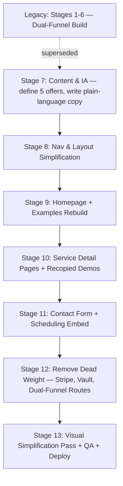

# IxMaOperations — Practical AI Automation for Solo Operators & Creators

> **Developer & Architecture Blueprint — v2 (Repositioning)**
> *Target Branch:* `dev` | *Primary Tech Stack:* Next.js 15 (React 19) / TypeScript / Tailwind CSS / Radix UI

---

## 0. Why This Version Exists

The v1 build (see `PLAN_PROGRESS.md` → "Legacy Build") was architected as a **dual-funnel Enterprise/Solopreneur platform** with Stripe checkout, an AES-256 client vault, a client portal, and four industrial computer-vision sandboxes (ALPR, manufacturing defect QC, invoice parsing, scraper terminal).

That build drifted from what's actually being sold. The real offer — per the pain-point research already on file for this project — is **done-for-you automation for solo operators, freelancers, VAs, and creators**, sold through a simple path: *see a practical example → get a quote or book a call*. The industrial/enterprise framing, the self-serve Stripe checkout, and the credential vault don't belong to that story and were confusing visitors.

**v2 goal:** one clean, minimalist site. No dual-funnel switch, no checkout, no vault. Five service offers shown as practical before/after examples, a contact form, and a scheduling link. Everything else is either retired or repurposed.

---

## 1. Project Mission & Executive Goal

**IxMaOperations** helps solo operators, freelancers, VAs, and content creators automate the repetitive administrative and production work that quietly eats 10–20 hours a week — content repurposing, lead prospecting, client onboarding, and media/receipt tagging — by mapping each manual grind to a small, concrete automation build.

```
[ Practical Example ]  →  [ "I want this" ]  →  [ Get a Quote / Book a Call ]  →  [ Scoped Project ]
```

One track. One story. No enterprise/solopreneur toggle.

### The 5 Core Service Offers
(Offers 1–3 and the pain point/tech stack for #4 are from the pain-point research already on file. Offer #4's tagline and all of Offer #5 were missing from that source and were drafted fresh on Aug 27, 2026 — confirmed with Emilio.)

| # | Offer | Manual Grind It Replaces | Practical Example on Site |
|---|---|---|---|
| 1 | **1-Click Content Engine** — turn 1 raw video into 15 multi-platform posts | Transcribing, summarizing, reformatting for X/LinkedIn/IG/newsletter by hand (10–12 hrs/wk) | Before/after: raw transcript → generated thread + carousel outline |
| 2 | **Automated Lead Intelligence** — scrape, enrich, and draft personalized outreach | Manually visiting profiles, copying data into spreadsheets, writing cold emails (8–15 hrs/wk) | Live terminal demo: scrape a sample profile list → enriched rows → drafted outreach line |
| 3 | **Zero-Touch Client Onboarding** — auto-provision on payment | Emailing for assets, creating Drive folders, building project boards, sending invoices by hand (6–10 hrs/wk) | Simple flow diagram: Payment → folder + board auto-created → welcome email sent |
| 4 | **AI Visual Asset Vault** — auto-tag, OCR, and log receipts/media | Renaming files, retyping receipt text, logging expenses by hand (5–8 hrs/wk) | Live demo: upload a receipt/invoice image → extracted line items in a table |
| 5 | **AI Inbox Copilot** — auto-sort, auto-answer FAQs, surface real leads | Manually triaging email/DM/comment inboxes, answering repetitive questions, and missing real leads in the noise (5–10 hrs/wk) | Static before/after: cluttered inbox → triaged view with auto-drafted replies (live demo is a possible Stage 14 add-on) |

#### Full Text — Offer #4 (tagline confirmed Aug 27, 2026)
* **Client-Centric Value Offer:** *"AI Visual Asset Vault: Turn a Shoebox of Receipts and Screenshots into a Searchable, Auto-Categorized Expense Log — Instantly."*
* (Manual grind and technical build stack were already on file — unchanged: CV/OCR pipeline, auto-crop and background-clean, key-value invoice extraction, vector embeddings indexed in Supabase `pgvector` for natural-language search.)

#### Full Text — Offer #5 (new, drafted and confirmed Aug 27, 2026 — not in original source notes)
* **Manual Grind (5–10 hrs/week):** Freelancers, creators, and solo consultants manually sift through email inboxes, Instagram/TikTok/X DMs, and post comments — answering the same handful of FAQs over and over, filtering spam and low-intent messages from real leads, and manually forwarding hot leads to their calendar or CRM.
* **Technical Build Stack:** FastAPI backend with an LLM intent-classification pipeline; RAG-based FAQ answering over Supabase `pgvector` (same retrieval infra as Offer #2's lead enrichment); inbox/DM API integrations (Gmail/Outlook, plus Instagram/TikTok/X where their APIs allow); a daily Slack/email digest of the items that still need a human.
* **Client-Centric Value Offer:** *"The AI Inbox Copilot: Auto-Sort, Auto-Answer FAQs, and Surface Only the Leads That Matter — In Real Time."*

---

## 2. Technical Stack & Architecture (v2 — Trimmed)

| Layer | Technologies | Purpose | Change from v1 |
|---|---|---|---|
| **Framework** | Next.js 15 / React 19 (App Router) | Pages, route handlers | Unchanged |
| **Language** | TypeScript v5+ | Type safety | Unchanged |
| **Styling** | Tailwind CSS + CSS Variables | Sober, minimal design system | Unchanged (see `STANDARDS.md`) |
| **UI Primitives** | Radix UI (`Dialog`, `Tabs` where still needed) | Accessible primitives | Trimmed — only what the 5 service pages + contact form need |
| **State** | React local state / Context | Sandbox demo state | Zustand **dropped** — the remaining 2 demos don't need a global store |
| **Forms & Validation** | React Hook Form + Zod | Contact/quote form | Unchanged, now used for one form instead of five |
| **Scheduling** | Calendly embed (`<iframe>` or official embed script) — confirmed | Book-a-call widget on `/contact` | **New** |
| **Contact/Quote Delivery** | Resend via `/api/contact` — account created | Emails form submissions to Emilio | **New** — replaces Stripe checkout + webhook as the primary conversion path |
| **Payments** | *(none for now)* | — | Stripe SDK, checkout route, and webhook **removed**. Reintroduce later only if/when a self-serve product is actually sold. |
| **Credential Handling** | *(none)* | — | AES-256 vault, `lib/crypto.ts`, `/api/vault`, `ApiKeyVault.tsx` **removed** — no client credentials are collected on this site. |
| **Database** | *(none required)* | — | Supabase/`pgvector` **deferred** — not needed until there's a reason to store leads instead of just emailing them. Revisit if volume grows. |

---

## 3. Directory & File Blueprint (v2)

```
IxMaOperations/
├── app/
│   ├── page.tsx                        # Home: hero, condensed services grid, process, CTA
│   ├── services/
│   │   └── [slug]/page.tsx             # One detail page per offer (problem → example → CTA)
│   ├── examples/page.tsx               # Practical examples gallery (before/after for all offers)
│   ├── contact/page.tsx                # Quote form + Calendly/Cal.com embed
│   ├── api/
│   │   ├── contact/route.ts            # Sends quote/contact submissions by email
│   │   └── sandbox/
│   │       ├── scrape/route.ts         # KEEP — repurposed as Lead Intelligence demo
│   │       └── invoice/route.ts        # KEEP — repurposed as Visual Asset Vault (OCR) demo
│   ├── layout.tsx                      # Root layout — single nav, no track switcher
│   └── globals.css
├── components/
│   ├── home/
│   │   ├── Hero.tsx                    # Repurposed from enterprise/HeroSection.tsx, copy rewritten
│   │   ├── ServicesGrid.tsx            # Repurposed from enterprise/ServicesMatrix.tsx
│   │   └── ProcessSteps.tsx            # New — "Discover → Build → Deliver" 3-step strip
│   ├── examples/
│   │   └── BeforeAfterSimulator.tsx    # KEEP as-is — already fits "practical example" framing
│   ├── sandboxes/
│   │   ├── ScraperTerminalSandbox.tsx  # KEEP — recopy for lead-prospecting framing
│   │   └── InvoiceParserSandbox.tsx    # KEEP — recopy for receipt/invoice OCR framing
│   ├── contact/
│   │   ├── ContactForm.tsx             # New
│   │   └── ScheduleEmbed.tsx           # New — Calendly/Cal.com iframe wrapper
│   └── ui/                             # KEEP: Button, Card, Badge, Input, Tabs
├── lib/
│   ├── services.ts                     # New — canonical array of the 5 offers (content model)
│   ├── email.ts                        # New — Resend/Nodemailer client for /api/contact
│   └── utils.ts                        # KEEP
```

### Removed entirely
- `app/(enterprise)/*`, `app/(solopreneur)/*` route groups (dual-funnel layouts, audit page, case-studies page, tools catalog, onboarding wizard, client portal)
- `app/api/checkout`, `app/api/webhooks/stripe`, `app/api/vault`
- `app/api/sandbox/alpr`, `app/api/sandbox/qc` (industrial demos with no matching offer)
- `components/enterprise/FeasibilityModal.tsx`, `ArchitectureDiagram.tsx`, `ROIStatsGrid.tsx`
- `components/solopreneur/*` (`ApiKeyVault.tsx`, `AsyncIntakeForm.tsx`, `MicroCheckoutButton.tsx`, `MicroSprintCard.tsx`)
- `components/sandboxes/AlprOcrSandbox.tsx`, `DefectQcSandbox.tsx`
- `lib/crypto.ts`, `lib/stripe.ts`, `lib/store.ts` (Zustand store — no longer needed)

**Note on `AlprOcrSandbox` and `DefectQcSandbox`:** these were built for an industrial B2B pitch (license-plate/container OCR, manufacturing defect heatmaps) that has no counterpart in the actual solo-operator offers. Retiring them rather than reskinning avoids stretching two demos to fit a story they weren't built for. If Emilio does want a computer-vision offer for creators/e-commerce sellers (e.g., product photo cleanup, background removal — this shows up in pain point 4's "custom CV" stack), one of these can be revived and recopied instead of built from scratch.

---

## 4. Development Stages (v2)



See `PLAN_PROGRESS.md` for the full checklist under each stage.

---

## 5. Coding Standards & Architectural Guardrails (v2)

1. **One funnel, one CTA family.** Every page's primary action is either "Get a Quote" (contact form) or "Book a Call" (scheduling embed). No pricing tiers, no checkout buttons, no enterprise/solopreneur toggle.
2. **No credential collection.** This site never asks a visitor for an API key, password, or payment credential. If that need reappears, treat it as a new, separately-scoped feature — don't resurrect `lib/crypto.ts` as a default.
3. **Every demo maps to a real offer.** A sandbox/interactive element only ships if it illustrates one of the 5 service cards. No demo exists purely to show off a technique.
4. **Strict types.** Component props and the `/api/contact` payload validated via Zod, same as v1.
5. **Design system stays.** The sober, minimal aesthetic in `STANDARDS.md` (zinc palette, no neon glows, no gradient text, max 4 nav links, one header CTA) already matches the "simple minimalist" direction — keep it, just drop the "Enterprise" framing language in the doc's examples.

---

*Authored for the IxMaOperations project — Branch: `dev`. Supersedes the dual-funnel positioning in v1 of this document (retained for reference in Section 0 and `PLAN_PROGRESS.md`).*
